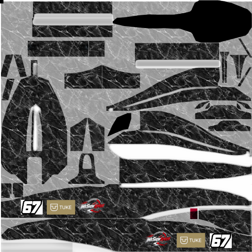

# WeShowSpeed livery



| File | What it is |
|------|------------|
| `car1-ow1.rgb` | Livery texture for the `car1-ow1` car model (SGI `.rgb`, 512×512, RGBA). |
| `car1-ow1-preview.png` | The same texture as PNG, for viewing on GitHub. |

Black marble body, car number **67**, team logo WeShowSpeed and our university logo (TUKE).

## How to install

Copy the texture into the `scr_server` driver slot used by our car (slot 0 = port 3001),
keeping the file name:

```
copy livery\car1-ow1.rgb <TORCS>\drivers\scr_server\0\car1-ow1.rgb
```

Restart TORCS completely — textures are cached at startup.
